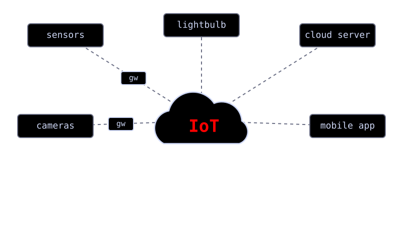
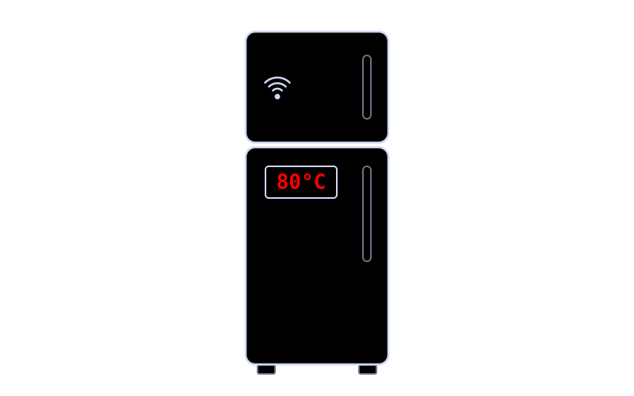

<!-- _class: one -->

# IoT Security

 Jacob Zepeda
 
---

# What is IoT?

- **Small devices** *(microcontroller, firmware, internet)*
- **Commonly found** *(sensors, fridges, lightbulbs, cars, cameras)*

---

# Breaking News

### French Refrigerator Hack
- **Open to the internet** 
  &nbsp; *(using default admin credentials)*
- **Temperatures overridden** 
  &nbsp; *(up to 176F, causing fires)*
- **700 supermarkets affected** 
  &nbsp; *($10m in lost goods)*
---

# Risks
- **Weak/Default Credentials** *(root:root, hardcoded in firmware)*
- **Misconfigurations** *(exposed endpoints)*
- **Unpatched Software** *(known CVEs and flaws)*
- **Legacy Encryption** *(RC4, DES)*
- **Firmware Vulnerabilities** *(buffer overflows, RCEs)*
- **Lack of Isolation** *lateral movement, pivoting*
- **Side Channels, Malware, Botnets, Financial loss** 

---

# Prevention

- **Change default passwords**
- **Update or remove old software**
- **Isolate devices from your network**
- **Buy from trusted vendors**
- **Analyze devices and network traffic**

---

<!-- _class: sources -->

- [cybersecuritynews.com](https://cybersecuritynews.com/)
- [spamhaus.com/threat-map](https://www.spamhaus.com/threat-map/)
- [ibm.com/think/topics/internet-of-things](https://www.ibm.com/think/topics/internet-of-things)
- [ibm.com/think/topics/encryption](https://www.ibm.com/think/topics/encryption)
- [shodan.io](https://www.shodan.io/)
- [safeguard.sh](https://safeguard.sh/resources/blog/hardcoded-credentials-in-firmware-cwe-798)
- [paulkocher.com: DPA ](https://www.paulkocher.com/doc/DifferentialPowerAnalysis.pdf)
- [chs.us](https://chs.us/2026/06/owasp-a04-cryptographic-failures-prevention/)
- [pentestpartners.com](https://www.pentestpartners.com/security-blog/how-to-do-firmware-analysis-tools-tips-and-tricks/)
- [book.rada.re](https://book.rada.re/analysis/code_analysis.html)
- [nvd.nist.gov](https://nvd.nist.gov/)
- [ipinfo.io](https://ipinfo.io/blog/france-fridges-hack)
- [code.nsa.gov](https://code.nsa.gov/)
